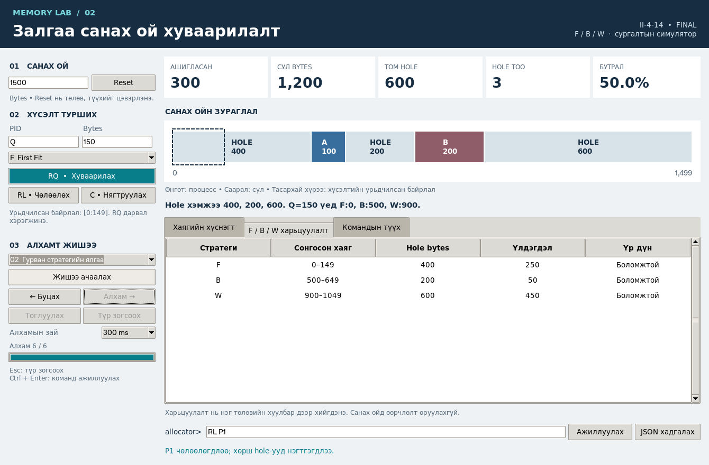

# Memory Lab  — Залгаа санах ой хуваарилалт

**F.CSM302 Үйлдлийн систем · Бие даалт 2 · II-4-14 · хувилбар 2.0.0**

First Fit, Best Fit, Worst Fit стратеги, сул зайн бутрал, нягтруулалтыг нэг тооцооллын цөмөөр загварчилсан Python/Tkinter сургалтын симулятор. Бодит RAM хуваарилахгүй.



## Баг

| Код | Гишүүн |
|---|---|
| B242270129 | Ө. Анар |
| B242270043 | М. Билэгжаргал |
| B231940032 | Н. Эрхэмбаяр |
| B241910006 | А. Хашчулуун |
| B241940042 | З. Өнөбилэг |

## Quick Start

Python 3.10+ хэлний боломж ашиглана. Бодитоор Python **3.12.14, 3.13.5**, GUI-г **Debian 13.7 / Python 3.13.5 / Tk 8.6** дээр шалгасан. Ердийн ажиллуулахад pip сан хэрэггүй.

Татсан ZIP-ээс шууд ажиллуулах: `cd source` → `python3 -m src.gui`.

Доорх clone команд нь **bd2-final branch-ийг GitHub-д оруулсны дараа** ажиллана. Одоогийн хүргэлтэд GitHub нийтлэлт хүлээгдэж байгаа; Manual-ийн 8-р хэсэгт bundle-ээс оруулах заавар бий.

```bash
git clone --branch bd2-final https://github.com/anrzeoui/OS_BD_II_4_14.git
cd OS_BD_II_4_14
python3 -m src.gui
```

Debian/Ubuntu дээр Tk байхгүй бол:

```bash
sudo apt install python3-tk
```

Windows дээр Python-ийн Tcl/Tk сонголттой суулгалт ашиглаж `python3`-ын оронд `py` хэрэглэнэ. Windows/macOS дээр энэ шинэ хувилбарын GUI-г тусад нь баталгаажуулаагүй.

CLI болон тест:

```bash
python3 -m src.cli 1048576 --file examples/book.txt
python3 -m src.cli 1000 --file examples/fragmentation.txt
python3 -m unittest discover -v
python3 -m tests.gui_smoke
```

`fragmentation.txt` зориуд татгалзах хүсэлттэй тул exit code **1** хэвийн. `book.txt` exit **0**. Буруу файл/encoding зэрэг аргументын алдаа **2**. GUI smoke нь дэлгэцтэй орчин шаарддаг. Цонхны хамгийн бага хэмжээ **1000×800**; 1340×880 дээр дэлгэрэнгүй харагдана.

## БД2 сайжруулалт

- Нэг төлөв дээр F/B/W харьцуулах хүснэгт; урьдчилсан тооцоо үндсэн төлөвийг өөрчлөхгүй.
- Хүсэлт байрлах хаягийг тасархай хүрээгээр урьдчилан харуулна.
- 3 тайлбарт жишээ, буцах/урагшлах, түр зогсоох, 300/900/1800 ms алхамын зай.
- 5 хэмжүүр, хаяг/харьцуулалт/түүхийн тусдаа таб, блокийн хаягийн тайлбар.
- CLI UTF-8 бус файлын traceback-ийг ойлгомжтой алдаагаар сольж, UTF-8 BOM дэмжсэн.
- 29 автомат тест, 33 GUI шалгалт; өмнөх 17 тест болон 2,000 санамсаргүй үйлдлийн oracle шалгалт хадгалагдсан.

Албан ёсны peer review ирээгүй тул өөрчлөлтийн үндэслэл нь **дотоод техникийн үнэлгээ**. Гаднын reviewer-ийн санал зохиож оруулаагүй.

## Гурван жишээ

1. **Бутрал ба нягтруулалт:** ачаалаад 5 алхам урагшил. Сул 500, том hole 300 тул P3=400 татгалзана. 6-р алхмын `C` дараа том hole 500; 7-р алхамд P3 [500:899] байрлана.
2. **Гурван стратегийн ялгаа:** 6 алхам дуусмагц Q=150 хүсэлтийн F/B/W хаяг тус тус 0/500/900. Сонгосон hole-ийн үлдэгдэл 250/50/450.
3. **Бүрэн дүүрэх ба чөлөөлөх:** 100 bytes санах ойг 40+60-аар дүүргэж, дараагийн 1 byte татгалзахыг харна. Хоёр процессыг чөлөөлөхөд нэг hole болно.

`← Буцах` нь зөвхөн ачаалсан жишээг өмнөх алхам хүртэл дахин тоглуулж сэргээнэ. Гар команд оруулахад жишээний горим дуусна. Reset болон жишээ ачаалах нь өмнөх төлөв/түүхийг шинэчилнэ; хэрэгтэй бол эхлээд JSON хадгална.

## Команд

| Команд | Утга |
|---|---|
| `RQ P0 100 F` | P0-д 100 bytes олгох; F/B/W сонгох |
| `RL P0` | P0-г чөлөөлж хөрш hole-уудыг нэгтгэх |
| `C` | Процессын дараалал/хэмжээг хадгалж зүүн тийш нягтруулах |
| `STAT` | Хаягийн inclusive мужуудыг хэвлэх |
| `X` | Гарах |

PID: латин үсгээр эхэлсэн 1–32 тэмдэгт, дараа нь үсэг/цифр/underscore; том жижиг үсэг ялгана. Нийт bytes 1..2^63−1, хүсэлт эерэг бүхэл тоо. Алдаатай хүсэлт төлөвийг өөрчлөхгүй. F/B/W ижил хэмжээтэй hole-оос бага хаягтайг сонгоно.

Бутрал = `1 - largest_hole / free`; `free=0` үед 0 гэж тодорхойлсон. **Бутрал 0% нь сул зай бий гэсэн үг биш.**

## Баримт ба нотолгоо

- [Final Report](docs/final/II-4-14_Final_Report.pdf)
- [Manual](docs/final/II-4-14_Manual.pdf)
- [Poster](docs/final/II-4-14_Poster.pdf)
- [Шинэ тестийн лог](evidence/bd2/final-tests.txt), [GUI лог](evidence/bd2/final-gui.txt)
- [Бодит жишээний JSON үр дүн](evidence/bd2/scenario-results.json)
- [Орчны хувилбарууд](evidence/bd2/environment.txt)
- [Release notes](docs/final/RELEASE_NOTES.md)

БД1-ийн Report/Manual болон зургууд `docs/` дотор түүхэн баримт болж хадгалагдсан. **Эцсийн хэрэглээнд `docs/final/`-ийг ашиглана.**

## Бүтэц

| Файл | Үүрэг |
|---|---|
| `src/allocator.py` | Block, Allocator, command parser; F/B/W, release, compact |
| `src/preview.py` | Хуулбар төлөв дээр 3 стратегийн урьдчилсан тооцоо |
| `src/scenarios.py` | Детерминист команд болон алхмын тайлбар |
| `src/gui.py` | Tkinter дэлгэц, after timer, snapshot түүх, JSON экспорт |
| `src/cli.py` | Интерактив болон UTF-8/BOM командын файл |
| `tests/` | Үндсэн, regression, GUI smoke тест |
| `evidence/bd2/` | Дахин туршилтын лог, JSON, бодит screenshot |

Жагсаалтад суурилсан цөмийн үйлдэл O(n); preview нь 3 хуулбар, back нь жишээний эхнээс replay хийдэг. Их хэмжээний process/history-д зориулсан гүйцэтгэлийн баталгаа байхгүй. GUI нь synchronous; үйлдлүүдийг зэрэгцээ thread ажиллаж байгаа мэт тайлбарлахгүй.

## Эх сурвалж

Silberschatz, Galvin, Gagne. *Operating System Concepts*, 10th ed., 2018, Chapter 9, §9.2, Contiguous Memory Allocation programming project (БД1 тайланд бүртгэсэн эх). F.CSM302, `OS_BD2_Guide.pdf`, х. 2–5.
