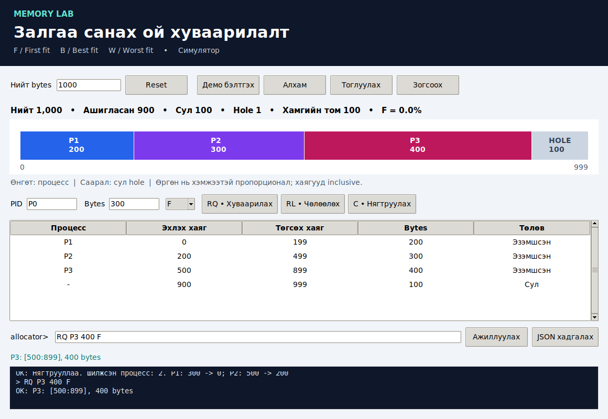

# Memory Lab
## Хэрэглэгчийн ба operational гарын авлага

F.CSM302 • Бие даалт 1 • II-4-14 

Зорилго: залгаа санах ой хуваарилалтын F/B/W стратеги, hole, fragmentation, compaction-ийг өөр оролтоор турших. Энэ нь симулятор; бодит RAM дээр процесс ажиллуулахгүй.

## 1. Орчин ба нээх

Python 3.10+ шаардлагатай. GUI-д Tkinter болон график desktop хэрэгтэй; CLI нь Tkinter-гүй ажиллана. Программыг ажиллуулахад pip dependency болон build алхам хэрэггүй. Кодын хавтасны нэр OS_BD_II_4_14.

### Debian / Ubuntu

ZIP-ийг задалж төслийн хавтсанд терминал нээнэ.

```bash
sudo apt install python3 python3-tk
cd OS_BD_II_4_14
python3 -m src.gui
```

### Windows PowerShell

Python-ийн суулгагчид Tcl/Tk бүрэлдэхүүн идэвхтэй байна. ZIP-ийг Extract All хийж, төслийн хавтас руу орно.

```powershell
cd OS_BD_II_4_14
py -3 -m src.gui
```

py танигдахгүй боловч Python суусан бол python --version шалгаад python -m src.gui ашиглаж болно. Командуудыг ZIP дотроос бус, задалсан хавтсаас ажиллуулна.

### Командын хувилбар

```bash
python3 -m src.cli 1048576
```

Windows дээр python3-ыг py -3-аар солино. allocator> prompt гармагц команд оруулна. MAX=1048576 нь 0..1048575 хаягийн муж.

<!-- PAGE -->

## 2. Удирдлага ба дүрслэл

| Удирдлага | Үйлдэл |
| --- | --- |
| Нийт bytes + Reset | Шинэ хэмжээ; бүх блок, түүхийг арилгана |
| PID / Bytes / F,B,W + RQ | Сонгосон стратегиар залгаа блок олгоно |
| PID + RL | Процессын блокийг чөлөөлж, хөрш hole нэгтгэнэ |
| C | Процессуудыг бага хаяг руу нягтруулна |
| Демо бэлтгэх | 1000 bytes шинэ төлөв; 8 алхмын жишээ |
| Алхам / Тоглуулах | Нэг алхам эсвэл 1.2 сек завсартай үргэлжлүүлэх |
| Зогсоох | Демо timer зогсоох; дараа үргэлжлүүлж болно |
| allocator> | Командыг бичээд Enter / Ажиллуулах |
| JSON хадгалах | Төлөв ба бүх командын өмнөх/дараах түүх |
| X / цонх хаах | Программаас гарах |

Гар командаар ажиллавал демо цуцлагдана. Демо дахин эхлэхдээ Демо бэлтгэх дарна. Reset өмнөх мэдээллийг арилгадаг тул шаардлагатай бол эхлээд JSON хадгална. JSON-ыг программ руу буцаан import хийх функц байхгүй.

Өнгөт блок = процесс, саарал = сул hole. Нарийн блокийн шошго нуугдаж болох ч хүснэгтэд яг хаяг, bytes харагдана. Хүснэгтийн процессын мөр дээр дарахад PID талбар сонгогдоно. Start, End нь хоёулаа багтсан муж; хэмжээ = End - Start + 1.

Нийт/ашигласан/сул нь bytes нэгжтэй. Hole = сул хэсгийн тоо; хамгийн том = хамгийн их залгаа сул хэмжээ. F = 1 - largest_hole / free; free=0 үед 0. F=0 нь RAM хангалттай гэсэн үг биш.

### Командын хэлбэр

```text
RQ P0 40000 W
RL P0
C
STAT
X
```

F = First Fit, B = Best Fit, W = Worst Fit. PID нь үсгээр эхэлсэн 1–32 латин үсэг/цифр/_; P0 ба p0 ялгаатай. Команд, стратегийн жижиг үсгийг зөвшөөрнө. Нийт хэмжээ 1..2^63-1; хүсэлт эерэг бүхэл тоо байна.

<!-- PAGE -->

## 3. Жишээ 1 - Номын команд

Нийт хэмжээг 1048576 болгоод Reset дарна. RQ P0 40000 W командыг ажиллуулна. P0 [0:39999] хаягийг эзэмшинэ; 1008576 bytes сул үлдэнэ. STAT нь эзэмшсэн болон сул хоёр мужийг харуулна. RL P0 хийсний дараа [0:1048575] нэг сул hole болно.

```bash
python3 -m src.cli 1048576 --file examples/book.txt
```

## 4. Жишээ 2 - Fragmentation ба compaction

GUI-д Демо бэлтгэх дараад Алхам товчоор дараах дарааллыг ажиглана.

| Алхам | Команд | Ажиглах үр дүн |
| --- | --- | --- |
| 1–3 | P0=300, P1=200, P2=300; F | 800 bytes ашигласан |
| 4 | RL P0 | Hole 300 ба 200; free=500 |
| 5 | RQ P3 400 F | Татгалзана: largest=300 |
| 6 | C | P1 start=0; P2 start=200; hole=500 |
| 7 | RQ P3 400 F | P3 [500:899], free=100 |
| 8 | STAT | Бүх хаягийн муж харагдана |



<!-- PAGE -->

## 5. Жишээ 3 - F/B/W харьцуулах

MAX=1500 болгоод дараах setup командыг оруулна.

```text
RQ P0 400 F
RQ A 100 F
RQ P1 200 F
RQ B 200 F
RL P0
RL P1
```

Дараа нь RQ Q 150 F хийвэл Q start=0. Reset хийж ижил setup-ийг давтаад RQ Q 150 B өгвөл start=500; дахин ижил setup дээр RQ Q 150 W өгвөл start=900. Стратеги бүрийг яг ижил эхний төлөвөөс харьцуулна.

## 6. Operational - эх код, build, run

Бодит GitHub URL одоогоор үүсгээгүй. Баг repo-оо нийтэлсний дараа YOUR_ACCOUNT-ыг бодит нэрээр сольж clone хийнэ. URL тодорхойгүй үед ZIP хувилбарыг ашиглана.

```bash
git clone https://github.com/anrzeoui/OS_BD_II_4_14.git
cd OS_BD_II_4_14
python3 --version
python3 -m tkinter
python3 -m src.gui
```

python3 -m tkinter нь Tk-ийн шалгах цонх нээнэ. Build/compile команд шаардлагагүй. GUI ба CLI нэг src/allocator.py цөм ашиглана; GUI-г өөрчлөхөд алгоритмын тусдаа хуулбар засах шаардлагагүй.

### Автомат шалгалт

```bash
python3 -m unittest discover -s tests -v
python3 -m tests.gui_smoke
```

Эхний команд 17 test OK, хоёр дахь нь desktop орчинд 14 checks passed гаргана. docs/test-results.txt болон docs/gui-test-results.txt нь бэлтгэсэн орчны бодит гаралт. Хэрэглэгчийн орчинд гарсан үр дүнг тусдаа хадгалж харьцуулна. Зураг авах сонголт --screenshots ашиглахад Pillow шаардлагатай; ердийн тестэд шаардлагагүй.

Туршсан орчин: Ubuntu 24.04.3 LTS, Python 3.12.14 core; системийн Python 3.12/Tk 8.6 GUI. Windows ба Debian дээрх алхмуудыг баг өөрийн төхөөрөмж дээр баталгаажуулна.

<!-- PAGE -->

## 7. Boundary/error test ба алдаа засах

| Оролт/алдаа | Хүлээгдэх байдал / шийдэл |
| --- | --- |
| MAX=1, RQ P0 1 F | [0:0] бүрэн эзэмшсэн; hole=0 |
| MAX=0, сөрөг, бутархай | Шинэ санах ой үүсгэхгүй, алдаа мэдээлнэ |
| RQ P0 0 F | Хэмжээ буруу; төлөв өөрчлөгдөхгүй |
| Нэг PID-г дахин RQ | Давхардсан PID алдаа |
| RL UNKNOWN | PID олдохгүй; төлөв хэвээр |
| RQ P0 20 Z | Стратеги F/B/W байх ёстой |
| free хүрэлцэхгүй | Бага хэмжээ хүсэх эсвэл процесс чөлөөлөх |
| free хүрэлцэнэ, largest хүрэхгүй | C хийж нягтруулах боломжийг шалгах |
| No module named src | Төслийн үндсэн хавтаснаас команд ажиллуулах |
| No module named tkinter | OS-ийн python3-tk / Python Tcl-Tk суулгах |
| no display / TclError | Desktop session ашиглах; эсвэл CLI ажиллуулах |
| Монгол үсэг эвдэрсэн | Unicode фонт, системийн Tk орчныг шалгах |

### Script exit code

Бүх команд амжилттай бол 0. Нэг ч гэсэн command error гарсан бол скриптийг үргэлжлүүлээд 1 буцаана. argparse оролтын алдаа 2 буцаана. examples/fragmentation.txt нь зориуд нэг хүсэлт татгалзуулах учир code 1 хүлээгдэнэ; энэ нь тестийн логийг унших шалтгаан бөгөөд программ crash гэсэн үг биш.

### Known issues ба хязгаарлалт

- Бодит процессын өгөгдөл, RAM, paging, swap, alignment загварчлаагүй.
- Нэг PID-д нэг блок; resize/realloc байхгүй.
- JSON нь үр дүн export; import/resume байхгүй.
- Олон блоктой үед хүснэгт/зураг шинэчлэхэд удаашрал гарч болно.
- Runtime-ийн Tk 9 орчинд Монгол үсгийн дүрслэлийн доголдол ажиглагдсан; системийн Tk 8.6 орчинд дахин шалгасан.

