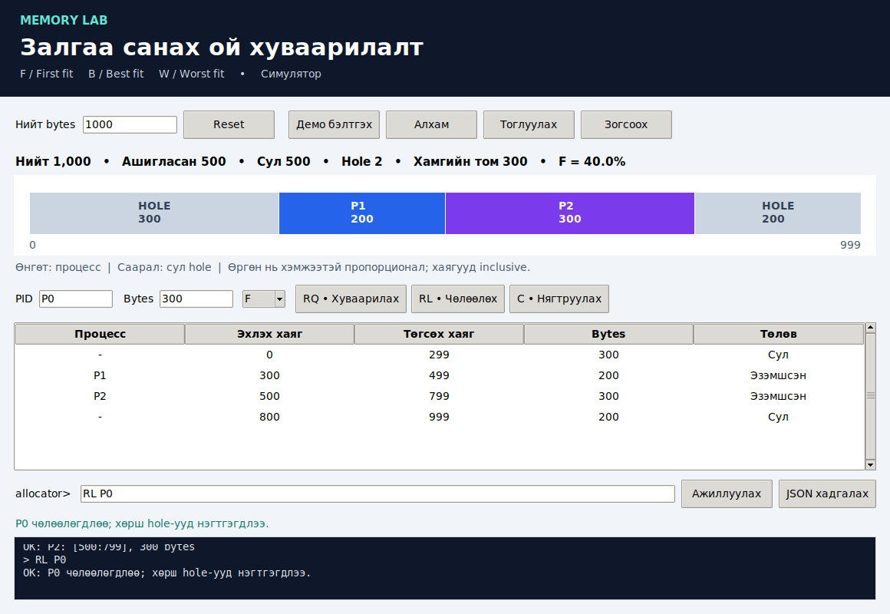
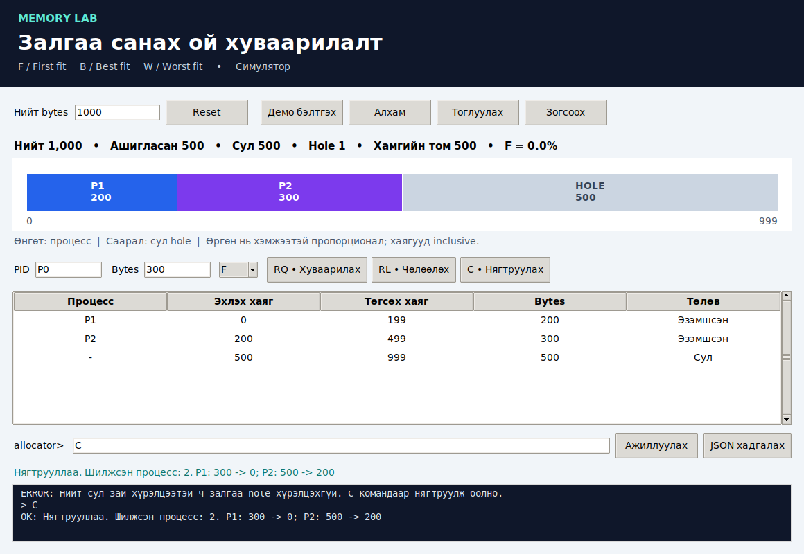

# Залгаа санах ой хуваарилалт
## Бие даалт 1 • Техникийн тайлан

ШУТИС - Мэдээлэл, холбооны технологийн сургууль

Хичээл: F.CSM302 Үйлдлийн систем

Төсөл: Contiguous Memory Allocation / Memory Lab

Хуваарилалтын код: II-4-14

Сурах бичиг: Operating System Concepts, 10 дахь хэвлэл, 2018; бүлэг 9, §9.2, Programming Projects P-48–P-50.

Огноо: 2026-10-24

**Хувилбарын төлөв:** Ажиллах код, туршилтын нотолгоо бүхий техникийн эх. Багийн гишүүдийн нэр, бодит GitHub холбоос, ажил хуваарилалт, commit/tag мэдээллийг нэмсний дараа илгээх хувилбар болгоно.

Хуваарилалтын файл дахь гишүүдийн код: B231940032, B241910006, B241940042, B242270043, B242270129. Нэрсийг баталгаажуулж нөхнө.

**Кодын зөрүү:** Хэрэглэгч II-2-14 гэж өгсөн боловч хуваарилалтын PDF-д B242270129 нь II-4-14 багт байна. Энэ тайлан PDF-ийн кодыг хэрэглэв; багшийн шинэчилсэн хуваарь байгаа бол өөрчилнө.

### Хураангуй

Энэхүү төсөл нь процесс бүрт нэг залгаа блок олгох санах ойн хуваарилалтыг загварчилна. First Fit, Best Fit, Worst Fit стратеги, санах ой чөлөөлөх, хөрш сул блокуудыг нэгтгэх, нягтруулах үйлдлийг нэг тооцооллын цөмд хэрэгжүүлэв. Командын хувилбар болон Tkinter цонх энэ цөмийг хамт ашигладаг. Үндсэн 17 тест, GUI-ийн 14 шалгалт тэнцсэн. Нийт 500 bytes сул боловч хамгийн том hole 300 bytes үед 400 bytes хүсэлт татгалзагдаж, нягтруулсны дараа амжилттай болсон нь external fragmentation-ийн нөлөөг харуулав.

<!-- PAGE -->

## 1. Удиртгал

Залгаа хуваарилалтад процессын эзэмшил нэг тасралтгүй хаягийн мужид байрлана. Процессууд өөр өөр хэмжээтэйгээр ирж, дуусахад сул зай олон хэсэгт тарж болно. Нийт сул зай хангалттай байх нь нэг хүсэлтийг хангах баталгаа болдоггүй. Энэ төслөөр сонголтын алгоритм, сул зайн бүтэц, нягтруулалтын харилцааг туршилтаар ойлгохыг зорив [1].

Хамрах хүрээ нь 0..MAX-1 логик хаягийн симуляц юм. Бодит RAM, kernel allocator, paging, swap, процессын бодит өгөгдөл шилжүүлэх ажиллагааг хэрэгжүүлээгүй. UI нь симуляцийн төлөвийг шууд харуулдаг.

## 2. Сурах бичгийн шаардлага

Номын шаардлагыг [1] болон багшийн UI, туршилт, баримтжуулалтын шаардлагыг [2, 3] дараах байдлаар хэрэгжүүлэв.

| Шаардлага | Хэрэгжилт | Шалгах нотолгоо |
| --- | --- | --- |
| Эхлэх үед MAX сонгох | CLI аргумент; GUI total/Reset | invalid_total, GUI reset |
| RQ PID size strategy | F/B/W блок сонгох, hole хуваах | first/best/worst_fit |
| RL PID | Блок чөлөөлөх, хөрш hole нэгтгэх | merge_both_neighbors |
| C | Процессын хаягийг шинэчлэн нягтруулах | compaction, GUI демо |
| STAT ба X | Хаягийн муж хэвлэх, гарах | CLI интеграц тест |
| Өөр параметрээр турших | MAX, PID, хэмжээ, стратеги | 3 example файл |
| Memory layout UI | Пропорционал зурвас + хаягийн хүснэгт | Бодит screenshot |
| Алдаа ба захын оролт | Validation; алдаанд төлөв хадгалах | invalid_requests_atomic |

Номын командуудыг хадгалсан. PID давхардлыг хориглох, ижил hole-оос бага хаягтайг сонгох, JSON түүх хадгалах нь энэ хэрэгжилтийн тодорхой болгосон нэмэлт шийдэл юм.

<!-- PAGE -->

## 3. Онолын үндэс

**First Fit (F):** Хаягийн өсөх дарааллаар эхний багтах hole-ийг сонгоно. **Best Fit (B):** Хүсэлтийг хангах hole-уудаас хамгийн багыг сонгоно. **Worst Fit (W):** Хамгийн том hole-ийг сонгоно. B ба W-д хэмжээ тэнцвэл бага хаягтайг сонгох тул үр дүн давтагдана [1].

**External fragmentation:** Сул зай олон салангид hole-д тарж, хүссэн хэмжээний нэг залгаа блок олдохгүй болох нөхцөл. **Coalescing:** Зэрэгцээ hole-уудыг нэгтгэнэ; эзэмшсэн процессыг хөдөлгөхгүй. **Compaction:** Эзэмшсэн блокуудыг бага хаяг руу шилжүүлж, сул зайг нэг блок болгоно. Эдгээр нь ялгаатай үйлдэл.

UI-ийн туслах үзүүлэлт: F = 1 - (хамгийн том hole / нийт сул зай). Нийт сул зай 0 бол F = 0 гэж тодорхойлов. Жишээ нь 300 ба 200 bytes hole-той үед F = 1 - 300/500 = 0.40. Энэ нь тархсан сул зайн харьцаа; стандарт гүйцэтгэлийн оноо эсвэл хүсэлтийн амжилтын магадлал биш.

Энэ загвар яг хүссэн хэмжээтэй блок олгодог тул alignment болон fixed-partition rounding-оос үүсэх internal fragmentation-ийг тооцоогүй. F = 0 ч бүрэн дүүрсэн санах ойд хүсэлт татгалзагдаж болох тул сул зай, хамгийн том hole үзүүлэлтийг хамт уншина.

## 4. Системийн зохиомж

Оролт нь CLI эсвэл GUI-ээс execute(model, command) руу дамжина. Parser нь RQ/RL/C/STAT/X командын хэлбэрийг шалгаж, Allocator-ийн үйлдлийг дуудна. Амжилттай үйлдлийн дараах snapshot нь GUI хүснэгт, memory layout, хэмжүүр болон JSON түүхийн эх үүсвэр болно. UI-д тусдаа хуваарилалтын алгоритм байхгүй.

Өгөгдлийн бүтэц: хаягийн дарааллаар эрэмбэлсэн Block(start, size, pid) жагсаалт. pid=None нь hole. Блокийн төгсгөл end = start + size - 1; хоёр төгсгөл орно. Объект immutable, blocks property tuple буцаадаг тул гаднаас жагсаалтыг санамсаргүй өөрчлөхөөс сэргийлнэ.

### Төлөвийн invariant

- Блокуудын хэмжээ эерэг, нийт хэмжээ MAX-тай тэнцүү.
- Эхний блок 0-оос эхэлнэ; сүүлийн блок MAX-1 дээр дуусна.
- Хөрш блокууд завсаргүй, давхцалгүй.
- Хоёр сул блок зэрэгцэн үлдэхгүй.
- Эзэмшсэн блок бүрийн PID давтагдахгүй.

<!-- PAGE -->

## 5. Хэрэгжилт

Python standard library, dataclasses, argparse, json, unittest болон Tkinter ашиглав. Үндсэн программд гуравдагч талын pip dependency байхгүй. CLI нь зураглалгүй орчинд мөн ажиллана.

| Функц | Гол шийдэл | Хугацаа |
| --- | --- | --- |
| request() | PID/size шалгах, багтах hole сонгох, үлдэгдэл үүсгэх | O(n) |
| release() | PID олох, чөлөөлөх, хөрш hole-уудыг нэгтгэх | O(n) |
| compact() | Эзэмшсэн блокуудыг дарааллаар нь зүүн тийш зөөх | O(n) |
| status()/snapshot() | Хаяг, хэмжүүр, төлөвийг гаргах | O(n) |

n нь процесс ба hole нийлсэн блокийн тоо. Жагсаалт болон түр жагсаалтын санах ойн хэрэглээ O(n). Python list-ийн insert/slice ажиллагаа бас O(n); First Fit-ийг энэ хэрэгжилтэд тогтмол хугацаатай гэж үзэхгүй.

request() нь өөрчлөлт хийхээс өмнө бүх validation болон hole сонголтыг дуусгана. Багтах hole олдохгүй бол exception үүсгэж, төлөвийг өөрчлөхгүй. Нийт сул хэмжээ хангалттай боловч хамгийн том hole хүрэлцэхгүй үед алдааны мессеж нягтруулах боломжийг тайлбарлана.

compact() нь процессын дараалал, хэмжээг хадгална; шинэ эхлэх хаягийг cursor-аар тооцож, өөрчлөгдсөн PID бүрийн хуучин/шинэ хаягийг буцаана. Сул зай байвал төгсгөлд ганц hole үүсгэнэ. Санах ой дүүрсэн үед 0 хэмжээтэй hole үүсгэхгүй.

## 6. Туршилт ба UI дүрслэл

Хэрэглэгч нийт хэмжээ, процессын нэр, хүсэлтийн хэмжээ, F/B/W-г өөрчилж туршина. RL үйлдлээр hole үүсгэнэ. Reset нь шинэ MAX-тай эхний төлөв үүсгэж, түүхийг арилгана. Демо нь алхамчилж эсвэл 1.2 секундийн завсартай явна. Зогсоох товч нь демогийн үргэлжлэлийг түр зогсооно; гар команд өгөхөд демо цуцлагдана.

Өнгөт хэсэг нь эзэмшсэн блок; саарал нь hole. Өргөн нь size/MAX-тай пропорционал. Нарийн блокийн текст багтахгүй үед доторх бичгийг нууж, яг хаяг, хэмжээг хүснэгтэд хадгална. Өнгө олон процесс дээр давтагдаж болох тул PID ба хаягаар ялгана. JSON export нь команд бүрийн өмнөх/дараах төлөв, амжилт/алдааг хадгалдаг.

<!-- PAGE -->

## 7. Туршилтын арга

Орчин: Ubuntu 24.04.3 LTS, үндсэн тест Python 3.12.14; GUI-г системийн Python 3.12 ба Tcl/Tk 8.6 ашигласан Xvfb дэлгэцэд ажиллуулсан. Windows болон хэрэглэгчийн Debian компьютерт энэ удаа туршаагүй. Runtime-ийн Tk 9 орчинд Монгол үсгийн дүрслэл доголдсон тул UI нотолгоог системийн Tk 8.6 орчинд дахин шалгав.

17 automated test нь нэгж, CLI интеграц, 2,000 үйлдлийн санамсаргүй тестийг хамарна. Санамсаргүй тест seed=14; 97 bytes санах ойг бие даасан per-byte occupancy array-тай үйлдэл бүрийн дараа тулгасан. Энэ oracle нь блокийн жагсаалтын хэрэгжилтийг хуулбарлаагүй.

GUI smoke шалгалт нь бодит цонх үүсгэн хүснэгт/модель нийцэл, алдаатай хүсэлт, нягтруулалт, JSON export, буруу reset, зөв reset, timer stop, гар командын дараах демо цуцлалт, хамгийн бага цонхны хэмжээг шалгасан. Энэ нь хүний бүх товшилт, бүх төхөөрөмжийн харагдах байдлын бүрэн баталгаа биш.

### Давтан ажиллуулах

```text
python3 -m unittest discover -s tests -v
python3 -m src.cli 1048576 --file examples/book.txt
python3 -m src.cli 1000 --file examples/fragmentation.txt
python3 -m tests.gui_smoke
```

Сүүлийн команд desktop шаарддаг. Fragmentation скрипт зориуд нэг алдаа үүсгэдэг тул exit code 1 хүлээгдэнэ; алдааны дараа командууд үргэлжилнэ.

## 8. Үр дүн

| Туршилт | Хүлээгдсэн / бодит үр дүн | Төлөв |
| --- | --- | --- |
| Номын RQ P0 40000 W, MAX=1048576 | P0 [0:39999]; үлдэгдэл 1008576 | PASS |
| F/B/W, holes 400/200/600, RQ 150 | Эхлэх хаяг F=0, B=500, W=900 | PASS |
| RL хоёр талын hole-той | Нэг сул блок [0:999] | PASS |
| Нийт free=500, largest=300; RQ 400 | Татгалзана, төлөв өөрчлөгдөхгүй | PASS |
| C дараа RQ P3 400 F | P3 [500:899], үлдэгдэл 100 | PASS |
| 1 byte / exact fit / full / empty | Хаяг ба hole тоо зөв | PASS |
| PID, size, strategy, syntax алдаа | Ойлгомжтой алдаа, төлөв хэвээр | PASS |
| Seed=14, 2,000 үйлдэл | Byte oracle-тай бүх төлөв таарсан | PASS |

<!-- PAGE -->

## 8.1. Fragmentation ба нягтруулалтын нотолгоо

MAX=1000 үед RQ P0 300 F, RQ P1 200 F, RQ P2 300 F, RL P0 үйлдлийг гүйцэтгэв. P1=[300:499], P2=[500:799], hole=[0:299] ба [800:999]. Нийт 500 bytes сул, хамгийн том hole 300; F=40%.



Дараагийн RQ P3 400 F хүсэлт татгалзагдана. C командаар P1 нь [0:199], P2 нь [200:499] болж шилжин, [500:999] хэмжээтэй 500 bytes нэг hole үүснэ. Нийт сул зай өөрчлөгдөөгүй, харин хамгийн том hole өссөн.



<!-- PAGE -->

## 8.2. Нягтруулсны дараах хүсэлт

RQ P3 400 F командыг дахин ажиллуулахад P3 [500:899] хаягийг эзэмшинэ. P1, P2-ийн хэмжээ хэвээр. Ашигласан 900 bytes, сул 100 bytes, hole=1, F=0%.


### Стратегиудыг нэг нөхцөлд харьцуулсан нь

MAX=1500. P0=400, A=100, P1=200, B=200-г дараалан олгоод P0, P1-г чөлөөлнө. Ингэхэд hole [0:399]=400, [500:699]=200, [900:1499]=600 үүснэ. Хувилбар бүр ижил эхний төлөвөөс Q=150 хүсэлт авна.

| Стратеги | Сонгосон hole | Q-ийн муж | Тухайн hole-ийн үлдэгдэл |
| --- | --- | --- | --- |
| First Fit | 400 bytes, start=0 | [0:149] | 250 bytes |
| Best Fit | 200 bytes, start=500 | [500:649] | 50 bytes |
| Worst Fit | 600 bytes, start=900 | [900:1049] | 450 bytes |

Энэ туршилт алгоритмууд өөр hole сонгосныг нотолно. Нэг жишээгээр бүх workload-д аль стратеги хамгийн сайн гэж дүгнээгүй; latency эсвэл throughput-ийн хэмжилт хийгээгүй.

<!-- PAGE -->

## 9. Хэлэлцүүлэг

Туршилт нь external fragmentation-ийг нийт сул зайн хэмжээнээс ялгаж харуулсан. Coalescing нь хөрш hole-уудыг нэгтгэх боловч хооронд нь процесс байгаа hole-уудыг нэгтгэж чадахгүй. Compaction ийм тохиолдолд процессын эхлэх хаягийг өөрчилдөг; симуляторт энэ нь metadata шинэчлэх үйлдэл, бодит системд өгөгдөл шилжүүлэх болон хаяг дахин байршуулах зардалтай [1].

Хязгаарлалт: Процесс бүр ганц блок эзэмшинэ. Alignment, paging, swap, concurrency, kernel integration, бодит RAM болон бодит relocation cost-ыг загварчлаагүй. Олон мянган блоктой үед Tkinter хүснэгт, зураг дахин зурах ажиллагаа удааширч болно. F хэмжүүрийг гүйцэтгэлийн нийтлэг үнэлгээ мэт хэрэглэхгүй. Windows болон Debian дээр баг өөрийн давтан туршилт хийх шаардлагатай.

### Багийн хамтын ажиллагааны төлөв

Одоогийн эхийг ChatGPT/Codex-оор бэлтгэж туршсан. Багийн нэрээр GitHub repository үүсгэж, push, release, Teams пост хийгээгүй. Гишүүд өөрийн ажил, өөрчлөлт, commit холбоос болон орчны тестийн нотолгоог нэмэх ёстой. Зохиомол contribution, commit эсвэл review дүн энэ тайланд оруулаагүй.

## 10. Дүгнэлт

Номын RQ, RL, C, STAT, X команд болон гурван allocation strategy хэрэгжсэн. UI нь нийт хэмжээ, хүсэлт, стратегийг өөрчилж, memory layout болон төлөвийг үйлдэл бүрийн дараа харуулна. 17 automated test, GUI-ийн 14 шалгалт тэнцсэн. 400 bytes хүсэлт өмнө нь татгалзагдаж, ижил нийт сул зайтай боловч нягтруулсан төлөвт амжилттай болсон нь залгаа сул хэсгийн хэмжээ чухал болохыг батлав.

Энэ нь бие даалтын техникийн эхний хэсгийн ажиллах хувилбар. Багийн мэдээлэл, GitHub баримтжуулалт, эцсийн нийтлэлт, оноогдсон багийн техникийн шүүмжийг дуусгаснаар бие даалтыг бүрэн гүйцэтгэнэ [2].

## Ашигласан материал

[1] A. Silberschatz, P. B. Galvin, G. Gagne. Operating System Concepts. 10th edition. Wiley, 2018. Chapter 9, §9.2; Programming Projects P-48–P-50. Хэрэглэгчийн хавсаргасан сурах бичиг.

[2] F.CSM302. Бие даалт 1: Үйлдлийн системийн программчлалын төслийг судлах, хэрэгжүүлэх, турших, тайлагнах болон харилцан шүүмжлэх. OS_BD1_Guide (1).pdf, х. 2–5.

[3] F.CSM302. Сэдэв ба шүүмж хийх хуваарилалт. OS_Topic_and_Peer_Review_Allocation.pdf, багийн хуваарь х. 1; 14-р сэдэв х. 3–4.

Хэрэгсэл: Python standard library, Tkinter/Tcl-Tk; баримт үүсгэх ReportLab; зураг ба GUI шалгах Pillow, Xvfb; эх бэлтгэх ChatGPT/Codex. Тестийн raw гаралт, screenshot-ууд docs/ дотор хавсаргасан.
